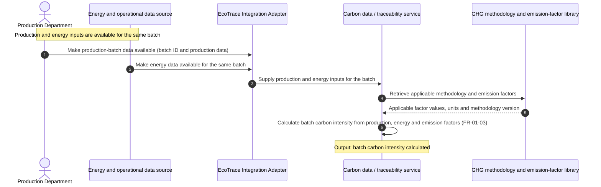

# Sequence Diagram: SD-UC-03 Access batch carbon intensity

| Field | Value |
|---|---|
| Use case | **UC-03 Access batch carbon intensity** (W0 / Use Case Diagram) |
| Primary actor | Production Department (provides production-batch data; the Must slice is data-triggered) |
| Version | v1.0 |
| FRs covered | **FR-01-03 (Must)** — Calculate batch carbon intensity |
| Related but excluded | FR-01-04 (Should) — View batch carbon intensity |
| Trigger | Production, energy and applicable emission-factor data are available for the same production batch. |

## Diagram

## Scope and reading notes

- This is the **Must-only calculation path** for UC-03. W4 confirms FR-01-03 as Must.
- The Production Department is the primary actor in W0 and the Use Case Diagram. In this slice, it supplies production-batch data; it does not select a batch in the UI or request a display.
- FR-01-04 (Should) describes a Production Department user selecting a batch and viewing its calculated carbon intensity and contributing data sources. That interaction is intentionally excluded from this Must-only sequence.
- The GHG methodology and emission-factor library is maintained through UC-02 / FR-01-02. UC-03 consumes the applicable factor data; it does not configure the library.
- The Integration Adapter is the physical-design element responsible for external-system communication. The source-system names for production and energy data are left generic because the repository documents are not fully aligned on the energy-source mapping.
- No persistence message is shown. FR-01-03 says the system SHALL calculate batch carbon intensity, but does not explicitly state where or how the result is stored. This remains an open point because FR-01-04 later requires retrieval.
- No missing-data or calculation-failure branch is invented: FR-01-03 is triggered only when production, energy and applicable emission-factor data are available, and W1 does not define a failure response for this use case.

## Traceability

| Sequence step | Interaction | Traceability |
|---|---|---|
| 1 | Production-batch data becomes available | Context Diagram: Production-batch data flow; FR-01-03 input condition |
| 2 | Energy data becomes available for the same batch | Context Diagram / W0 data functions; FR-01-03 input condition |
| 3 | Integration Adapter supplies both input sets to the Carbon data / traceability service | Architecture: Integration Adapter and Carbon data / traceability service; FR-01-03 |
| 4–5 | Retrieve applicable methodology and emission factors | FR-01-03 input condition; supporting library maintained under FR-01-02 / UC-02 |
| 6 | Calculate batch carbon intensity | FR-01-03 (Must) |

## Open questions

| # | Question | Impact |
|---|---|---|
| 1 | Which production and energy source systems are authoritative, and what is the exact integration path? The Context Diagram shows Production supplying production-batch and energy data; W0 Table 4 names SCADA and iLotusLand for energy/operational emissions; Architecture does not consistently identify those sources. | Confirm source lifelines and Integration Adapter mapping. |
| 2 | Must the calculated batch carbon intensity be persisted, and in which data entity/store? FR-01-04 (Should) expects the value to be retrievable, but FR-01-03 and W0 Table 4 do not explicitly define a batch-carbon-intensity data store. | Confirm storage and downstream retrieval design; add or clarify a requirement if needed. |
| 3 | What formula, unit, allocation boundary and effective-date rule select the applicable emission factors for a batch? | Needed for detailed calculation logic and acceptance tests; not specified in FR-01-03. |
| 4 | What should happen when one of the required inputs is missing, inconsistent or arrives late? | No failure/hold/retry behavior is modeled until a rule or FR is approved. |

*Source baseline: W0 Table 1 and Table 4; W1 FR-01-03 and FR-01-04; W4 prioritization; Use Case Diagram; Architecture v1.1.*