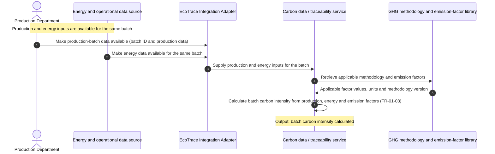

# Sequence Diagram: SD-UC-03 Access batch carbon intensity (Must-only)

| Field | Value |
|---|---|
| Use case | **UC-03 Access batch carbon intensity** (W0 / Use Case Diagram) |
| Primary actor | Production Department (provides production-batch data; the Must slice is data-triggered) |
| Version | v1.0 |
| FRs covered | **FR-01-03 (Must)** — Calculate batch carbon intensity |
| Related but excluded | FR-01-04 (Should) — View batch carbon intensity |
| Trigger | Production, energy and applicable emission-factor data are available for the same production batch. |

This is the **Must-only calculation path** for UC-03. W4 confirms FR-01-03 as Must. The Production Department is the primary actor in W0 and the Use Case Diagram. In this slice, it supplies production-batch data; it does not select a batch in the UI or request a display. FR-01-04 (Should) describes a Production Department user selecting a batch and viewing its calculated carbon intensity and contributing data sources. That interaction is intentionally excluded from this Must-only sequence.

