# Sequence Diagram: SD-UC-12 Monitor, track, and export system audit logs

| Field | Value |
|---|---|
| Use case | UC-12 Monitor, track, and export system audit logs |
| Version | v1.0 |
| FRs | FR-04-04 (Must) — Record system audit logs |

This is the Must-only slice of UC-12. W4 confirms FR-04-04 as Must; FR-04-05 and FR-04-06 are Should and are intentionally excluded. W0 names **System Admin / Auditor** as UC-12's primary actor. The FR-04-04 trigger, however, is any user performing a system-altering action. That user initiates the source action; the Admin/Auditor is the intended audit-log stakeholder, not the person who manually creates each log entry.

```mermaid
sequenceDiagram
    autonumber

    actor U as User performing a system-altering action

    participant F as Originating EcoTrace feature
    participant ACC as Access and audit service / Event Listener
    participant DB as EcoTrace audit log database

    U->>F: Perform a system-altering action

    F->>ACC: Emit system-altering action event (action, user ID, payload)

    ACC->>ACC: Capture action, user ID, timestamp and payload (FR-04-04)

    ACC->>DB: Store immutable audit log entry (FR-04-04)

    DB-->>ACC: Audit entry persisted

    Note over ACC,DB: Audit recording is automatic&#59; no manual edit or deletion is part of this Must flow.
```

